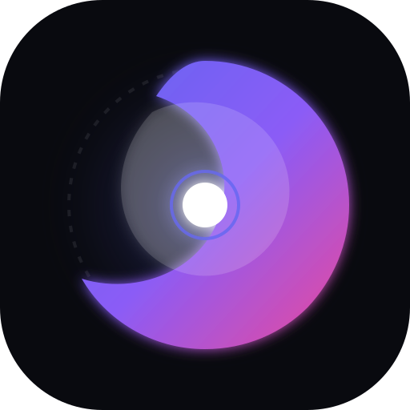
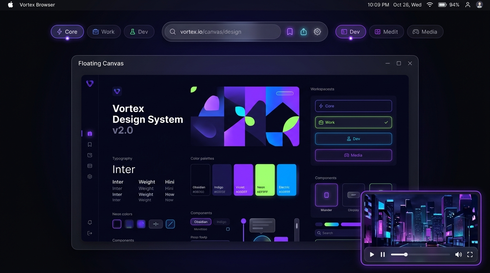

<p align="center">
  
</p>

<h1 align="center">Vortex Browser</h1>

<p align="center">
  <b>דפדפן מתקדם מבוסס מנוע פיירפוקס (Gecko Quantum) עם קנבס צף, חללי עבודה (Spaces) ועיצוב סייבר-מינימליסטי ייחודי.</b><br>
  <i>A next-generation browser built on Mozilla's Gecko Quantum engine with floating canvas, spaces, and cyber-minimalist aesthetics.</i>
</p>

<p align="center">
  
</p>

---

## ⚡ התקנה מהירה בפקודה אחת (1-Click Install)

### 🪟 Windows (ב-PowerShell):
```powershell
irm https://raw.githubusercontent.com/dor2500/vortex-browser/main/install.ps1 | iex
```
*ההתקנה מגדירה את הדפדפן, יוצרת קיצור דרך בשולחן העבודה ובתפריט ההתחלה ומפעילה את Vortex מיד.*

### 🍏 macOS / 🐧 Linux (בטרמינל):
```bash
curl -fsSL https://raw.githubusercontent.com/dor2500/vortex-browser/main/install.sh | bash
```
*ב-macOS נוצרת אפליקציית `Vortex Browser.app` וב-Linux נוצר `.desktop` launcher ופקודת `vortex` ב-Terminal.*

---

## 🌟 סקירה כללית (Overview)

**Vortex Browser** הוא פרוייקט דפדפן חדש שנולד מתוך השראת **Drift Browser**, אך עם שינוי יסודי בליבה ובעיצוב:
1. **מנוע Gecko אמיתי (Mozilla Quantum)**: במקום להסתמך על Chromium או Electron, הדפדפן רץ כולו על מנוע הרינדור Gecko ועל מנוע ה-JS SpiderMonkey של פיירפוקס — ללא טלמטריה, עם Total Cookie Protection וביצועי רינדור מתקדמים (WebRender).
2. **עיצוב שונה לחלוטין מפיירפוקס**:
   - **Floating Canvas (קנבס צף)**: עמוד האינטרנט אינו מוצמד לקצוות המסך בצורה מיושנת, אלא צף ככרטיס מעוגל (`border-radius: 14px`) עם הצללות עומק וגבולות זכוכית (Glassmorphism).
   - **Pill Omnibar**: שורת כתובת צפה ומעוגלת במרכז, המגיבה עם אפקטי תאורה ומצב חיפוש ממוקד.
   - **Picture-in-Picture (Window-in-Window) מובנה**: חלון צף ליוטיוב וסרטונים עם בקרות מלאות, כתוביות, כפתור מעוצב מעל הנגן, כפתור בשורת הכתובת ומעבר אוטומטי ל-PiP בעת מזעור או מעבר בין כרטיסיות (`Auto-PiP`). קיצור דרך: `Ctrl+Shift+]`.
   - **Spaces / חללי עבודה**: תמיכה מלאה בהפרדת כרטיסיות לפי נושאים (ראשי, עבודה, פיתוח, מדיה) תוך ניצול יכולות ה-Multi-Account Containers של Gecko.
   - **עמוד פתיחה (New Tab) עוצר נשימה**: שעון דיגיטלי, ברכות משתנות לפי שעה, מעבר בין מנועי חיפוש בלחיצה אחת (Google, DuckDuckGo, Brave, Bing, Startpage), חיוג מהיר לקיצורי דרך וסטטוס הגנת פרטיות.
   - **תמיכה מלאה בעברית (RTL)** ובאנגלית בלחיצת כפתור אחת.
   - **ערכות נושא מובנות**: Obsidian Dark, Cyberpunk Neon, Nord Frost.

---

## 🚀 הרצה מהירה (Quick Start)

### דרישות מוקדמות:
- מותקן במחשב Mozilla Firefox (או מנוע Gecko תואם).
- Windows (PowerShell) או macOS / Linux.

### הפעלה ב-Windows (PowerShell):
פתח את הטרמינל בתיקיית הפרוייקט והרץ:
```powershell
npm start
# או ישירות דרך הסקריפט:
powershell -ExecutionPolicy Bypass -File .\scripts\launch.ps1
```

> [!NOTE]
> הדפדפן מופעל בסביבה מבודדת לחלוטין (`.profile/`) עם הדגל `-no-remote`, כך שהוא **לעולם אינו נוגע** או משפיע על הפרופיל והנתונים האישיים של הפיירפוקס הרגיל שלך.

### הפעלה ב-Linux / macOS:
```bash
npm run start:linux
# או:
bash ./scripts/launch.sh
```

---

## 📁 מבנה הפרוייקט (Architecture)

```text
vortex-browser/
├── package.json               # פקודות הפעלה, בנייה ופרטי הפרויקט
├── README.md                  # תיעוד ומדריך מלא
├── assets/
│   └── icon.svg               # סמליל המותג (Vortex)
├── scripts/
│   ├── launch.ps1             # סקריפט הרצה עצמאי ל-Windows
│   ├── launch.sh              # סקריפט הרצה ל-Linux/macOS
│   ├── build.mjs              # סנכרון והכנת קבצי ה-Chrome
│   └── clean.mjs              # ניקוי פרופיל בדיקות מבודד
└── src/
    ├── chrome/
    │   ├── userChrome.css     # המהפך העיצובי: קנבס צף, הסתרת סרגלים ישנים, עיצוב לשוניות
    │   └── userContent.css    # עיצוב אחיד לדפי Gecko הפנימיים וסרגלי גלילה מודרניים
    ├── config/
    │   ├── user.js            # הגדרות מנוע Gecko (חסימת טלמטריה, WebRender, Containers)
    │   └── policies.json      # מדיניות Enterprise (התקנת uBlock Origin, הגדרות פרטיות)
    └── pages/
        └── newtab/            # עמוד פתיחה מעוצב (HTML/CSS/JS)
            ├── index.html
            ├── style.css
            └── script.js
```

---

## 🛡️ פרטיות ואבטחה מובנית (Hardened Gecko)

קובץ ה-[`user.js`](file:///C:/Users/Dorp/.gemini/antigravity/scratch/vortex-browser/src/config/user.js) כולל הקשחת מנוע מקיפה:
- **0 טלמטריה**: כיבוי מלא של שליחת נתונים ל-Mozilla (`telemetry`, `normandy`, `shield`, `healthreport`).
- **ביטול תכני חסות**: כיבוי Pocket, קישורים ממומנים בטאב חדש ומעקבי Snippets.
- **הגנה ממעקב (Tracking Protection)**: הגנה מחמירה על עוגיות צד שלישי (Total Cookie Protection), הגנה מטביעות אצבע וחסימת כורי קריפטו.
- **מדיניות תוספים מובנית**: תמיכה בהתקנה שקטה ואוטומטית של חוסם הפרסומות והמעקב **uBlock Origin** דרך [`policies.json`](file:///C:/Users/Dorp/.gemini/antigravity/scratch/vortex-browser/src/config/policies.json).

---

## 🎨 התאמה אישית (Customization)

ניתן להרחיב ולשנות את העיצוב בקלות:
- עיצוב הממשק הראשי נשלט כולו בקובץ [`userChrome.css`](file:///C:/Users/Dorp/.gemini/antigravity/scratch/vortex-browser/src/chrome/userChrome.css).
- עיצוב דף הבית ועמוד הטאב החדש מנוהל בתיקיית [`src/pages/newtab/`](file:///C:/Users/Dorp/.gemini/antigravity/scratch/vortex-browser/src/pages/newtab/).
- צבעי מפתח ומשתני עיצוב מוגדרים תחת `:root` בראשי הקבצים.

---

## 📄 רישיון (License)

פרוייקט זה מופץ תחת רישיון **MIT**.
נוצר בהשראת פרויקט [Drift Browser](https://github.com/dor2500/drift-browser).

